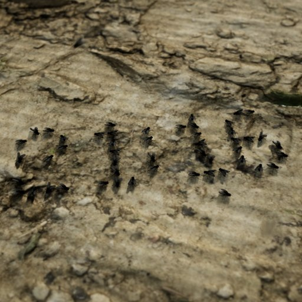
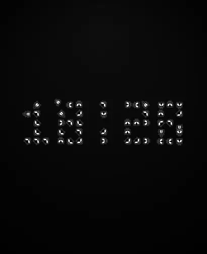

# microClocks

Uhren aus Fliegen und Oxyd-Murmeln für vier Plattformen: die Smartwatch Bangle.js 2, ein ESP32-S3 mit AMOLED-Display, Wallpaper Engine (als Web-Wallpaper und als Unreal-Engine-5-Programm) und den Windows-PC. Jede Minute formieren sich Fliegen oder Murmeln neu zu den Ziffern der Uhrzeit. Berührt man das Glas oder bewegt die Maus, fliegen die Fliegen auf und finden über Umwege zurück; Murmeln lassen sich kippen und anschubsen.

| Fliegen 3D (Unreal, Wallpaper Engine) | Oxyd 3D (Unreal, Wallpaper Engine) | Fliegen im ESP32-Simulator |
|---|---|---|
|  |  |  |

Video der Fliegenuhr als Wallpaper: [dev/media/FliesClockWallpaper.mp4](dev/media/FliesClockWallpaper.mp4)

## Uhren und Plattformen

| Uhr | Bangle.js 2 | ESP32-Simulator und Web-Wallpaper | PC und Unreal-Wallpaper |
|---|:-:|:-:|:-:|
| FliesClock (weiß auf schwarz) | ✔ | ✔ | |
| FliesClock (schwarz auf weiß) | ✔ | | |
| FliesClock 3D | | | ✔ |
| Murmeln | ✔ | ✔ | ✔ |
| Oxyd | ✔ | ✔ | |
| Oxyd groß, Oxyd Boden | | ✔ | |
| Oxyd-Glasmurmeln | | | ✔ |
| Bahnuhr, Bahnuhr ohne Sekunden | ✔ | | |

- **Bangle.js 2** (`bangle/`): Espruino-Skripte für das 176 × 176 große 3-Bit-Display, mit Fast Load. Die Fliegenuhr schläft, solange keine Fliege fliegt; Berühren oder kräftiges Schütteln scheucht die Fliegen auf.
- **ESP32** (`esp32/`): Firmware für das Waveshare ESP32-S3-Touch-AMOLED-2.06 (410 × 502) mit PlatformIO. Bisher ein Grundgerüst mit Display und Echtzeituhr; die Zifferblätter laufen im Browser-Simulator `esp32/sim`.
- **Wallpaper Engine, Web** (`wallpaper/`): dieselben Zifferblätter als Web-Wallpaper mit Einstellungen für Zifferblatt, Boden, Größe und Ton.
- **PC und Wallpaper Engine, Unreal** (`pc/FlyClock3D`): Unreal-Engine-5-Projekt mit gescannten Fliegen, die laufen, fliegen und mit den Flügeln schlagen, sowie Oxyd-Steinen und Glasmurmeln auf Waldboden, Sand, Gras oder Straße. Als Wallpaper gibt es zwei Programm-Wallpapers, „Fliegen 3D“ und „Oxyd 3D“.

## Voraussetzungen

- Windows mit Node.js und Python 3 (mit Pillow für den Sprite-Generator)
- für die ESP32-Firmware: PlatformIO
- für den PC: Unreal Engine 5 und Visual Studio mit „Desktopentwicklung mit C++“
- für die Wallpapers: Wallpaper Engine (Steam)
- für die Übertragung auf die Bangle: eine Bluetooth-Laufzeit der µGulp-Entwicklungsumgebung

Die Unreal-Assets liegen über Git LFS im Repository. Nach dem Klonen also `git lfs install` und `git lfs pull` ausführen.

## Bedienung über µGulp

Build, Start, Vorschau, Commit und Sicherung laufen über das gemeinsame `gulpfile.mjs` im µGulp-Dashboard. Nach `npm install` wählt man oben in der Steuerleiste die Uhr; die Tasks passen sich an und blenden Plattformen aus, für die es die Uhr nicht gibt.

| Task | Zweck |
|---|---|
| Einrichten | prüft alle Werkzeuge und installiert npm-Pakete, Pillow und PlatformIO nach |
| Uhr auf die Bangle | überträgt das Skript per Bluetooth, mit Vorschau, Sicherung und Rückleseprüfung |
| Bangle-Vorschau | FliesClock im Browser auf einer Nachbildung des Bangle-Displays |
| ESP32-Simulator | Zifferblätter im Browser auf 410 × 502 |
| ESP32-Firmware bauen | PlatformIO-Build, auf Wunsch mit Upload |
| PC-Uhr bauen, PC-Uhr starten | Unreal-Projekt bauen, fehlende Assets einrichten, Uhr im Fenster starten |
| Wallpaper bauen | Web-Wallpaper oder die beiden Unreal-Wallpapers packen und in Wallpaper Engine installieren |
| Wallpaper-Vorschau | Web-Wallpaper im Browser |
| Git-Commit | nur die Dateien eines Teilprojekts committen |
| Sichern | alles, was sich nicht neu bauen lässt, auf ein Sicherungslaufwerk kopieren |

Ohne µGulp lassen sich die Browserteile auch mit einem einfachen Server im Repository-Stamm ansehen, zum Beispiel `python -m http.server 8799` und dann `http://localhost:8799/esp32/sim/`.

## Web-Wallpaper

- Vorschau: Task „Wallpaper-Vorschau“ öffnet `wallpaper/` im Browser, mit der gewählten Uhr.
- Paketierung: Task „Wallpaper bauen“ mit der Fassung „Web“ ruft `wallpaper/build.py` auf und schreibt das Paket nach `dist/wallpaper`.
- Installation: Mit „In Wallpaper Engine installieren“ landet es lokal in `steamapps/common/wallpaper_engine/projects/myprojects/microClocks`.
- Eigenschaften in Wallpaper Engine: Zifferblatt, Boden bei „Oxyd Boden“, Größe, Ausweichen der Fliegen vor dem Mauszeiger, Ton und Lautstärke.

## Unreal-Wallpapers

- Start am PC: Task „PC-Uhr starten“ baut das Projekt, richtet fehlende Assets ein und öffnet die Uhr im Fenster.
- Paketierung: Task „Wallpaper bauen“ mit der Fassung „Unreal“ packt das Projekt (Win64, Shipping) und legt die Projekte `microClocks-ue-flies` und `microClocks-ue-oxyd` an. Das erste Packen dauert lange.
- Installation: lokal in `myprojects` wie beim Web-Wallpaper. Danach Wallpaper Engine ganz beenden und neu starten, damit neue Einträge erscheinen.

Wallpaper Engine gibt Programm-Wallpapers weder Eigenschaften noch Tastatur weiter, nur Mausposition und linke Maustaste. Deshalb erscheint bei Mausbewegung unten eine Knopfleiste:

- Uhr (bei Oxyd: Steine oder Glasmurmeln), Boden und bei den Fliegen das Ziffernraster (3 × 5, 4 × 7, 5 × 7)
- Drehen, Flacher, Steiler, Näher, Weiter und Grundansicht
- Ton in vier Stufen
- drei Speicherplätze: Klicken ruft eine Einstellung ab, eine Sekunde Halten speichert die aktuelle

Die Einstellungen bleiben je Wallpaper erhalten. In Wallpaper Engine sind Programm-Wallpapers standardmäßig ausgeblendet: unter „Installiert“ → „Ergebnisse filtern“ den Typ „Anwendung“ einschalten.

## Sprachen

Quelltexte sind en-US, Übersetzungen liegen als i18x-Tabellen vor (zunächst Deutsch):

| Bereich | Übersetzungen |
|---|---|
| Gulp-Tasks, Formulare und Protokolle | `i18x/gulp/<Sprache>.json` |
| ESP32-Simulator und Bangle-Vorschau | `i18x/web/<Sprache>.json` |
| Eigenschaften des Web-Wallpapers | `i18x/wallpaper/<Sprache>.json` |
| Knopfleiste der Unreal-Uhr | `pc/FlyClock3D/Content/i18x/<Sprache>.json` |

Die Sprache folgt der Einstellung von Windows bzw. des Browsers; im Browser wählt `?lang=de-DE` sie gezielt, in der Unreal-Uhr der Schalter `-lang=de-DE`. Die Bahnuhr auf der Bangle nimmt Wochentag und Monat aus der Spracheinstellung der Uhr.

## Aufbau

| Ordner | Inhalt |
|---|---|
| `bangle/` | Uhren für Bangle.js 2, Werkzeuge zur Übertragung und zum Erzeugen der Fliegen-Sprites, Browser-Vorschau |
| `esp32/` | PlatformIO-Firmware und Browser-Simulator |
| `pc/FlyClock3D/` | Unreal-Engine-5-Projekt, Start über `run.ps1` |
| `wallpaper/` | Web-Wallpaper, gepackt von `build.py` |
| `shared/` | gemeinsame Zifferblätter und Assets für Simulator und Web-Wallpaper |
| `gulp/` | Implementierung der Gulp-Tasks |
| `i18x/` | Übersetzungen |
| `dev/media/` | Vorschauvideos und -animationen |

## Einschränkungen

- Die ESP32-Firmware zeigt bisher nur Uhrzeit aus der Echtzeituhr; Touch, Lagesensor, Ton und Energieverwaltung fehlen. Die Zifferblätter gibt es nur im Simulator.
- Die Bangle-Vorschau im Browser bildet nur die Grafikaufrufe der FliesClock nach; Farben und Tempo weichen von der Uhr ab. Die Fliegenuhr ist auf einer echten Bangle noch nicht getestet.
- Die Übertragung auf die Bangle braucht die µGulp-Entwicklungsumgebung und schreibt erst nach Bestätigung im Dashboard.
- Programm-Wallpapers nimmt der Steam Workshop nicht mehr an; die Unreal-Wallpapers sind nur zur lokalen Installation gedacht.
- Übersetzungen gibt es bisher nur für Deutsch.

## Dokumentation

Diese Datei `README.de-DE.src.md` ist die führende Quelle der README. Geplant ist eine Übersetzung nach en-US und die Zusammenführung beider Sprachen in `README.md`; ein Generator dafür existiert noch nicht. Bis dahin verweist `README.md` nur auf diese Datei.

## Rechte

Fliegen-Sprites und Oxyd-Grafiken: Meinolf Amekudzi. Wald-, Boden- und Holztexturen der Unreal-Uhr stammen von [Poly Haven](https://polyhaven.com) (CC0).
