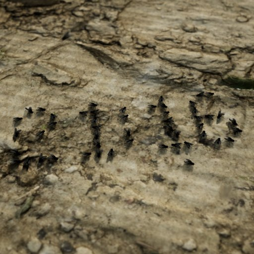
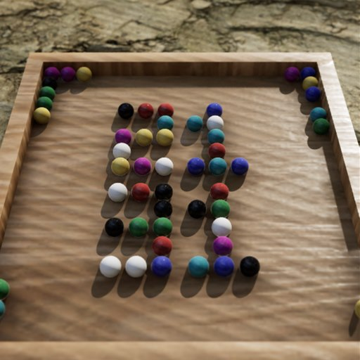
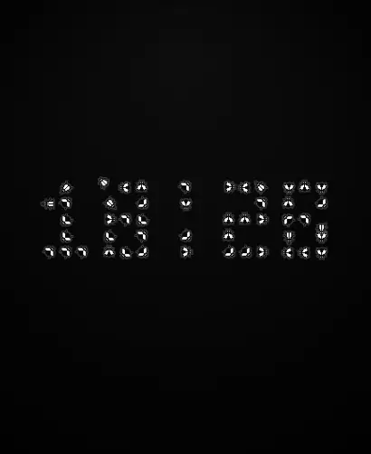

# microClocks

[English](#english) · [Deutsch](#deutsch)

## English

Clocks made of flies and Oxyd marbles for four platforms: the Bangle.js 2 smartwatch, an ESP32-S3 with AMOLED display, Wallpaper Engine (as a web wallpaper and as an Unreal Engine 5 application) and the Windows PC. Every minute, flies or marbles regroup into the digits of the time. Touch the glass or move the mouse and the flies take off and find their way back by detours; marbles can be tilted and nudged.

| Flies 3D (Unreal, Wallpaper Engine) | Oxyd 3D (Unreal, Wallpaper Engine) | Flies in the ESP32 simulator |
|---|---|---|
|  |  |  |

Video of the fly clock as a wallpaper: [dev/media/FliesClockWallpaper.mp4](dev/media/FliesClockWallpaper.mp4)

**Try it in the browser:** [mamekudz.github.io/microClocks](https://mamekudz.github.io/microClocks/) shows the ESP32 simulator with all faces, the Bangle preview of FliesClock and Espruino emulator links for the other Bangle clocks (the page is in German).

### Download the wallpapers

The Steam Workshop does not accept application wallpapers. The ready-made wallpapers are therefore available under [Releases](https://github.com/mamekudz/microClocks/releases):

- `microClocks-ue-flies.zip`: Flies 3D (Unreal Engine)
- `microClocks-ue-oxyd.zip`: Oxyd 3D with Oxyd stones and glass marbles (Unreal Engine)
- `microClocks-web.zip`: web wallpaper with all faces of the simulator

Installation: extract the ZIP file into `steamapps/common/wallpaper_engine/projects/myprojects` so that a folder such as `microClocks-ue-flies` appears there. Then quit Wallpaper Engine completely (taskbar → Quit) and start it again. The Unreal wallpapers are application wallpapers: under "Installed" → "Filter results", enable the type "Application".

The changes of each version are listed in [RELEASES.json](RELEASES.json).

### Clocks and platforms

| Clock | Bangle.js 2 | ESP32 simulator and web wallpaper | PC and Unreal wallpaper |
|---|:-:|:-:|:-:|
| FliesClock (White on Black) | ✔ | ✔ | |
| FliesClock (Black on White) | ✔ | | |
| FliesClock 3D | | | ✔ |
| Marbles | ✔ | ✔ | ✔ |
| Oxyd | ✔ | ✔ | |
| Oxyd large, Oxyd floor | | ✔ | |
| Oxyd glass marbles | | | ✔ |
| Railway clock, railway clock without seconds | ✔ | | |

- **Bangle.js 2** (`bangle/`): Espruino scripts for the 176 × 176 3-bit display, with Fast Load. The fly clock sleeps while no fly is flying; touching or shaking it hard startles the flies. The two fly clocks are named "FliesClock (White on Black)" and "FliesClock (Black on White)".
- **App Loader:** `bangle/bangleapps/` contains the sources for these two clocks and for Oxyd, each at version 0.01. They are not in the official Bangle App Loader yet. None of these clocks has been tested on a real watch.
- **ESP32** (`esp32/`): firmware for the Waveshare ESP32-S3-Touch-AMOLED-2.06 (410 × 502) with PlatformIO. So far a skeleton with display and real-time clock; the faces run in the browser simulator `esp32/sim`.
- **Wallpaper Engine, web** (`wallpaper/`): the same faces as a web wallpaper with settings for face, floor, size and sound.
- **PC and Wallpaper Engine, Unreal** (`pc/FlyClock3D`): Unreal Engine 5 project with scanned flies that walk, fly and beat their wings, plus Oxyd stones and glass marbles on forest floor, sand, grass or road. As wallpapers there are two application wallpapers, "Flies 3D" and "Oxyd 3D".

### Requirements

- Windows with Node.js and Python 3 (with Pillow for the sprite generator)
- for the ESP32 firmware: PlatformIO
- for the PC: Unreal Engine 5 and Visual Studio with "Desktop development with C++"
- for the wallpapers: Wallpaper Engine (Steam)
- for transferring to the Bangle: a Bluetooth runtime of the µGulp development environment

The Unreal assets are stored in the repository via Git LFS. After cloning, run `git lfs install` and `git lfs pull`.

### Working with µGulp

Build, start, preview, commit and backup run through the shared `gulpfile.mjs` in the µGulp dashboard. After `npm install`, choose the clock in the control bar at the top; the tasks adapt and hide platforms the clock does not exist on.

| Task | Purpose |
|---|---|
| Set up | checks all tools and installs npm packages, Pillow and PlatformIO |
| Program to Bangle | transfers the script via Bluetooth, with preview, backup and read-back check |
| Preview Bangle | FliesClock in the browser on a replica of the Bangle display |
| ESP32 simulator | faces in the browser at 410 × 502 |
| Build ESP32 firmware | PlatformIO build, optionally with upload |
| Build PC clock, start PC clock | build the Unreal project, set up missing assets, start the clock in a window |
| Build wallpaper | package the web wallpaper or the two Unreal wallpapers and install them into Wallpaper Engine |
| Wallpaper preview | web wallpaper in the browser |
| Git commit | commit only the files of one subproject |
| Back up | copy everything that cannot be rebuilt to a backup drive |

Without µGulp, the browser parts can also be viewed with a simple server in the repository root, for example `python -m http.server 8799` and then `http://localhost:8799/esp32/sim/`.

### Web wallpaper

- Preview: the task "Wallpaper preview" opens `wallpaper/` in the browser with the selected clock.
- Packaging: the task "Build wallpaper" with the edition "Web" runs `wallpaper/build.py` and writes the package to `dist/wallpaper`.
- Installation: with "Install into Wallpaper Engine" it is placed locally in `steamapps/common/wallpaper_engine/projects/myprojects/microClocks`.
- Properties in Wallpaper Engine: face, floor for "Oxyd floor", size, flies avoiding the mouse pointer, sound and volume.

### Unreal wallpapers

- Start on the PC: the task "Start PC clock" builds the project, sets up missing assets and opens the clock in a window.
- Packaging: the task "Build wallpaper" with the edition "Unreal" packages the project (Win64, Shipping) and creates the projects `microClocks-ue-flies` and `microClocks-ue-oxyd`. The first packaging takes a long time.
- Installation: locally in `myprojects` like the web wallpaper. Afterwards quit Wallpaper Engine completely and restart it so that new entries appear.

Wallpaper Engine passes neither properties nor keyboard input to application wallpapers, only the mouse position and the left mouse button. A button bar therefore appears at the bottom when the mouse moves:

- clock (for Oxyd: stones or glass marbles), floor and, for the flies, the digit grid (3 × 5, 4 × 7, 5 × 7)
- rotate, flatter, steeper, closer, farther and default view
- sound in four levels
- three save slots: a click recalls a setting, holding for one second saves the current one

The settings are kept per wallpaper. Wallpaper Engine hides application wallpapers by default: under "Installed" → "Filter results", enable the type "Application".

### Languages

Source texts are en-US; translations are i18x tables (German so far):

| Area | Translations |
|---|---|
| Gulp tasks, forms and logs | `i18x/gulp/<language>.json` |
| Release notes in `RELEASES.json` | `i18x/gulp/releases/<language>.json` |
| ESP32 simulator and Bangle preview | `i18x/web/<language>.json` |
| Web wallpaper properties | `i18x/wallpaper/<language>.json` |
| Button bar of the Unreal clock | `pc/FlyClock3D/Content/i18x/<language>.json` |

The language follows the Windows or browser setting; in the browser `?lang=de-DE` selects it explicitly, in the Unreal clock the switch `-lang=de-DE`. The railway clock on the Bangle takes weekday and month from the watch's language setting.

### Structure

| Folder | Contents |
|---|---|
| `bangle/` | clocks for Bangle.js 2, tools for transferring and for generating the fly sprites, browser preview, App Loader sources |
| `esp32/` | PlatformIO firmware and browser simulator |
| `pc/FlyClock3D/` | Unreal Engine 5 project, started via `run.ps1` |
| `wallpaper/` | web wallpaper, packaged by `build.py` |
| `shared/` | shared faces and assets for the simulator and the web wallpaper |
| `gulp/` | implementation of the Gulp tasks |
| `i18x/` | translations |
| `dev/media/` | preview videos and animations |

### Limitations

- So far the ESP32 firmware only shows the time from the real-time clock; touch, motion sensor, sound and power management are missing. The faces exist only in the simulator.
- The Bangle preview in the browser only replicates the graphics calls of FliesClock; colours and speed differ from the watch. The fly clock has not yet been tested on a real Bangle.
- Transferring to the Bangle requires the µGulp development environment and writes only after confirmation in the dashboard.
- The Steam Workshop no longer accepts application wallpapers; the Unreal wallpapers are meant for local installation only.
- Translations exist only for German so far.

### Documentation

`README.de-DE.src.md` (German) is the leading source of this README. This file contains the English translation first and then the German text with headings one level lower. Both are merged by hand; there is no generator.

### Rights

Fly sprites and Oxyd graphics: Meinolf Amekudzi. Forest, ground and wood textures of the Unreal clock are from [Poly Haven](https://polyhaven.com) (CC0).

## Deutsch

Uhren aus Fliegen und Oxyd-Murmeln für vier Plattformen: die Smartwatch Bangle.js 2, ein ESP32-S3 mit AMOLED-Display, Wallpaper Engine (als Web-Wallpaper und als Unreal-Engine-5-Programm) und den Windows-PC. Jede Minute formieren sich Fliegen oder Murmeln neu zu den Ziffern der Uhrzeit. Berührt man das Glas oder bewegt die Maus, fliegen die Fliegen auf und finden über Umwege zurück; Murmeln lassen sich kippen und anschubsen.

| Fliegen 3D (Unreal, Wallpaper Engine) | Oxyd 3D (Unreal, Wallpaper Engine) | Fliegen im ESP32-Simulator |
|---|---|---|
|  |  |  |

Video der Fliegenuhr als Wallpaper: [dev/media/FliesClockWallpaper.mp4](dev/media/FliesClockWallpaper.mp4)

**Ausprobieren im Browser:** [mamekudz.github.io/microClocks](https://mamekudz.github.io/microClocks/) zeigt den ESP32-Simulator mit allen Zifferblättern, die Bangle-Vorschau der FliesClock und Links in den Espruino-Emulator für die übrigen Bangle-Uhren.

### Wallpapers herunterladen

Der Steam Workshop nimmt Programm-Wallpapers nicht an. Die fertigen Wallpapers gibt es deshalb unter [Releases](https://github.com/mamekudz/microClocks/releases):

- `microClocks-ue-flies.zip`: Fliegen 3D (Unreal Engine)
- `microClocks-ue-oxyd.zip`: Oxyd 3D mit Oxyd-Steinen und Glasmurmeln (Unreal Engine)
- `microClocks-web.zip`: Web-Wallpaper mit allen Zifferblättern des Simulators

Installation: Die ZIP-Datei nach `steamapps/common/wallpaper_engine/projects/myprojects` entpacken, sodass dort ein Ordner wie `microClocks-ue-flies` entsteht. Dann Wallpaper Engine ganz beenden (Taskleiste → Beenden) und neu starten. Die Unreal-Wallpapers sind Programm-Wallpapers: unter „Installiert“ → „Ergebnisse filtern“ den Typ „Anwendung“ einschalten.

Was sich je Version geändert hat, steht in [RELEASES.json](RELEASES.json) (en-US, deutsche Übersetzung in `i18x/gulp/releases/de-DE.json`).

### Uhren und Plattformen

| Uhr | Bangle.js 2 | ESP32-Simulator und Web-Wallpaper | PC und Unreal-Wallpaper |
|---|:-:|:-:|:-:|
| FliesClock (White on Black) | ✔ | ✔ | |
| FliesClock (Black on White) | ✔ | | |
| FliesClock 3D | | | ✔ |
| Murmeln | ✔ | ✔ | ✔ |
| Oxyd | ✔ | ✔ | |
| Oxyd groß, Oxyd Boden | | ✔ | |
| Oxyd-Glasmurmeln | | | ✔ |
| Bahnuhr, Bahnuhr ohne Sekunden | ✔ | | |

- **Bangle.js 2** (`bangle/`): Espruino-Skripte für das 176 × 176 große 3-Bit-Display, mit Fast Load. Die Fliegenuhr schläft, solange keine Fliege fliegt; Berühren oder kräftiges Schütteln scheucht die Fliegen auf. Die beiden Fliegenuhren heißen „FliesClock (White on Black)“ und „FliesClock (Black on White)“.
- **App Loader:** `bangle/bangleapps/` enthält die Quellen für diese beiden Uhren und für Oxyd, jeweils Version 0.01. Sie sind noch nicht im offiziellen Bangle-App-Loader. Auf einer echten Uhr ist keine dieser Uhren getestet.
- **ESP32** (`esp32/`): Firmware für das Waveshare ESP32-S3-Touch-AMOLED-2.06 (410 × 502) mit PlatformIO. Bisher ein Grundgerüst mit Display und Echtzeituhr; die Zifferblätter laufen im Browser-Simulator `esp32/sim`.
- **Wallpaper Engine, Web** (`wallpaper/`): dieselben Zifferblätter als Web-Wallpaper mit Einstellungen für Zifferblatt, Boden, Größe und Ton.
- **PC und Wallpaper Engine, Unreal** (`pc/FlyClock3D`): Unreal-Engine-5-Projekt mit gescannten Fliegen, die laufen, fliegen und mit den Flügeln schlagen, sowie Oxyd-Steinen und Glasmurmeln auf Waldboden, Sand, Gras oder Straße. Als Wallpaper gibt es zwei Programm-Wallpapers, „Fliegen 3D“ und „Oxyd 3D“.

### Voraussetzungen

- Windows mit Node.js und Python 3 (mit Pillow für den Sprite-Generator)
- für die ESP32-Firmware: PlatformIO
- für den PC: Unreal Engine 5 und Visual Studio mit „Desktopentwicklung mit C++“
- für die Wallpapers: Wallpaper Engine (Steam)
- für die Übertragung auf die Bangle: eine Bluetooth-Laufzeit der µGulp-Entwicklungsumgebung

Die Unreal-Assets liegen über Git LFS im Repository. Nach dem Klonen also `git lfs install` und `git lfs pull` ausführen.

### Bedienung über µGulp

Build, Start, Vorschau, Commit und Sicherung laufen über das gemeinsame `gulpfile.mjs` im µGulp-Dashboard. Nach `npm install` wählt man oben in der Steuerleiste die Uhr; die Tasks passen sich an und blenden Plattformen aus, für die es die Uhr nicht gibt.

| Task | Zweck |
|---|---|
| Einrichten | prüft alle Werkzeuge und installiert npm-Pakete, Pillow und PlatformIO nach |
| Uhr auf die Bangle | überträgt das Skript per Bluetooth, mit Vorschau, Sicherung und Rückleseprüfung |
| Bangle-Vorschau | FliesClock im Browser auf einer Nachbildung des Bangle-Displays |
| ESP32-Simulator | Zifferblätter im Browser auf 410 × 502 |
| ESP32-Firmware bauen | PlatformIO-Build, auf Wunsch mit Upload |
| PC-Uhr bauen, PC-Uhr starten | Unreal-Projekt bauen, fehlende Assets einrichten, Uhr im Fenster starten |
| Wallpaper bauen | Web-Wallpaper oder die beiden Unreal-Wallpapers packen und in Wallpaper Engine installieren |
| Wallpaper-Vorschau | Web-Wallpaper im Browser |
| Git-Commit | nur die Dateien eines Teilprojekts committen |
| Sichern | alles, was sich nicht neu bauen lässt, auf ein Sicherungslaufwerk kopieren |

Ohne µGulp lassen sich die Browserteile auch mit einem einfachen Server im Repository-Stamm ansehen, zum Beispiel `python -m http.server 8799` und dann `http://localhost:8799/esp32/sim/`.

### Web-Wallpaper

- Vorschau: Task „Wallpaper-Vorschau“ öffnet `wallpaper/` im Browser, mit der gewählten Uhr.
- Paketierung: Task „Wallpaper bauen“ mit der Fassung „Web“ ruft `wallpaper/build.py` auf und schreibt das Paket nach `dist/wallpaper`.
- Installation: Mit „In Wallpaper Engine installieren“ landet es lokal in `steamapps/common/wallpaper_engine/projects/myprojects/microClocks`.
- Eigenschaften in Wallpaper Engine: Zifferblatt, Boden bei „Oxyd Boden“, Größe, Ausweichen der Fliegen vor dem Mauszeiger, Ton und Lautstärke.

### Unreal-Wallpapers

- Start am PC: Task „PC-Uhr starten“ baut das Projekt, richtet fehlende Assets ein und öffnet die Uhr im Fenster.
- Paketierung: Task „Wallpaper bauen“ mit der Fassung „Unreal“ packt das Projekt (Win64, Shipping) und legt die Projekte `microClocks-ue-flies` und `microClocks-ue-oxyd` an. Das erste Packen dauert lange.
- Installation: lokal in `myprojects` wie beim Web-Wallpaper. Danach Wallpaper Engine ganz beenden und neu starten, damit neue Einträge erscheinen.

Wallpaper Engine gibt Programm-Wallpapers weder Eigenschaften noch Tastatur weiter, nur Mausposition und linke Maustaste. Deshalb erscheint bei Mausbewegung unten eine Knopfleiste:

- Uhr (bei Oxyd: Steine oder Glasmurmeln), Boden und bei den Fliegen das Ziffernraster (3 × 5, 4 × 7, 5 × 7)
- Drehen, Flacher, Steiler, Näher, Weiter und Grundansicht
- Ton in vier Stufen
- drei Speicherplätze: Klicken ruft eine Einstellung ab, eine Sekunde Halten speichert die aktuelle

Die Einstellungen bleiben je Wallpaper erhalten. In Wallpaper Engine sind Programm-Wallpapers standardmäßig ausgeblendet: unter „Installiert“ → „Ergebnisse filtern“ den Typ „Anwendung“ einschalten.

### Sprachen

Quelltexte sind en-US, Übersetzungen liegen als i18x-Tabellen vor (zunächst Deutsch):

| Bereich | Übersetzungen |
|---|---|
| Gulp-Tasks, Formulare und Protokolle | `i18x/gulp/<Sprache>.json` |
| Versionshinweise in `RELEASES.json` | `i18x/gulp/releases/<Sprache>.json` |
| ESP32-Simulator und Bangle-Vorschau | `i18x/web/<Sprache>.json` |
| Eigenschaften des Web-Wallpapers | `i18x/wallpaper/<Sprache>.json` |
| Knopfleiste der Unreal-Uhr | `pc/FlyClock3D/Content/i18x/<Sprache>.json` |

Die Sprache folgt der Einstellung von Windows bzw. des Browsers; im Browser wählt `?lang=de-DE` sie gezielt, in der Unreal-Uhr der Schalter `-lang=de-DE`. Die Bahnuhr auf der Bangle nimmt Wochentag und Monat aus der Spracheinstellung der Uhr.

### Aufbau

| Ordner | Inhalt |
|---|---|
| `bangle/` | Uhren für Bangle.js 2, Werkzeuge zur Übertragung und zum Erzeugen der Fliegen-Sprites, Browser-Vorschau, Quellen für den App Loader |
| `esp32/` | PlatformIO-Firmware und Browser-Simulator |
| `pc/FlyClock3D/` | Unreal-Engine-5-Projekt, Start über `run.ps1` |
| `wallpaper/` | Web-Wallpaper, gepackt von `build.py` |
| `shared/` | gemeinsame Zifferblätter und Assets für Simulator und Web-Wallpaper |
| `gulp/` | Implementierung der Gulp-Tasks |
| `i18x/` | Übersetzungen |
| `dev/media/` | Vorschauvideos und -animationen |

### Einschränkungen

- Die ESP32-Firmware zeigt bisher nur Uhrzeit aus der Echtzeituhr; Touch, Lagesensor, Ton und Energieverwaltung fehlen. Die Zifferblätter gibt es nur im Simulator.
- Die Bangle-Vorschau im Browser bildet nur die Grafikaufrufe der FliesClock nach; Farben und Tempo weichen von der Uhr ab. Die Fliegenuhr ist auf einer echten Bangle noch nicht getestet.
- Die Übertragung auf die Bangle braucht die µGulp-Entwicklungsumgebung und schreibt erst nach Bestätigung im Dashboard.
- Programm-Wallpapers nimmt der Steam Workshop nicht mehr an; die Unreal-Wallpapers sind nur zur lokalen Installation gedacht.
- Übersetzungen gibt es bisher nur für Deutsch.

### Dokumentation

`README.de-DE.src.md` ist die führende Quelle der README. `README.md` enthält zuerst die englische Übersetzung und danach diesen deutschen Text mit um eine Ebene tieferen Überschriften. Beides wird von Hand zusammengeführt, einen Generator gibt es nicht: Inhaltliche Änderungen zuerst in `README.de-DE.src.md` vornehmen, dann in `README.md` den deutschen und den englischen Teil nachziehen.

### Rechte

Fliegen-Sprites und Oxyd-Grafiken: Meinolf Amekudzi. Wald-, Boden- und Holztexturen der Unreal-Uhr stammen von [Poly Haven](https://polyhaven.com) (CC0).
